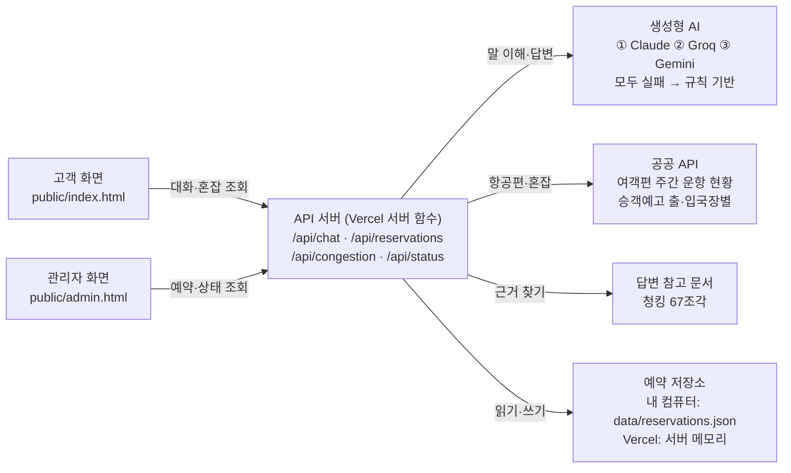
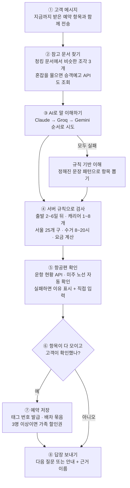
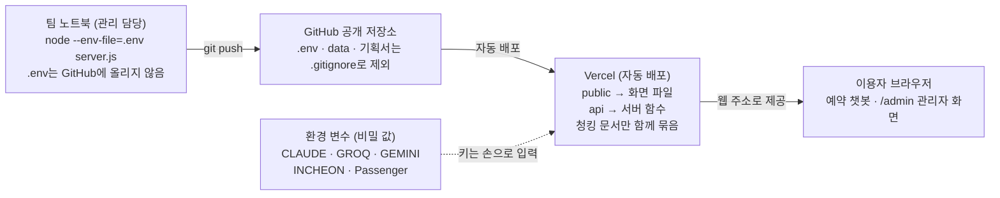

# 홈드랍 예약·안내 챗봇

집에서 캐리어를 수거해 인천국제공항까지 옮겨 주는 **홈드랍** 서비스를, 고객이 **대화로 예약**하고 운영자가 **관리자 화면에서 배차**를 확인하는 생성형 AI 챗봇 데모입니다.

> 요금·시간·배차·할인권 값은 모두 **시연용 데모 값**입니다. 실제 서비스와 다를 수 있습니다.

## 서비스 흐름

1. **챗봇으로 예약** — 대화로 정보를 입력하고 확인
2. **집에서 수거** — 기사가 방문해 태그를 붙임
3. **공항으로 이동** — 권역별로 묶어 배차
4. **공항 인도** — 고객은 빈손으로 출국

이 데모는 1번의 예약 대화와, 2·3번을 관리하는 관리자 화면을 구현합니다.

## 주요 기능

**고객 화면 (`/`)**
- 챗봇이 필요한 정보를 한두 개씩 물으며 예약을 받습니다 (고객 정보 → 주소 → 항공편 → 사전 확인 → 짐 → 수거 시각 → 확인)
- 요금, 수거 시간, 금지 물품, 이용 지역을 안내합니다
- 터미널별 혼잡 시간대(교통 안내)를 보여 줍니다
- 3명 이상 예약에는 공항버스 가족 할인권을 발급합니다
- 답마다 **근거 이름**(참고 문서 또는 API 이름)을 붙이고, 데모 값에는 「데모 값」이라고 밝힙니다

**관리자 화면 (`/admin`)**
- 예약 표와 배차 보드 (접수 → 배차 완료 → 수거 완료 → 공항 인도)
- AI · 공공 API 연결 상태 확인

## 시스템 설계도

PDF 원본: [홈드랍 시스템 설계도 (PDF)](docs/홈드랍_시스템_설계도.pdf)

### 1. 전체 구성도

고객 화면과 관리자 화면이 API 서버를 부르고, API 서버가 생성형 AI · 공공 API · 참고 문서 · 예약 저장소를 씁니다.



- **규칙은 서버가 정합니다.** 요금·날짜·개수·할인권 대상은 서버 코드가 계산하고, AI는 말을 항목으로 바꾸고 설명만 합니다. 자격을 단정하지 않습니다.
- **외부 호출은 서버에서만** 합니다. AI와 공공 API 키는 서버에만 있고 화면 파일에는 없습니다.

### 2. 챗봇 한 번의 처리 흐름

고객이 한 번 말할 때마다 `/api/chat` 안에서 일어나는 순서입니다.



물어보는 순서: 정보 → 주소 → 항공편 → 사전 확인 3가지 → 짐 → 동반 인원 → 수거 시각 → 확인

### 3. 배포 구조

팀 노트북에서 고친 코드가 인터넷 주소로 나가기까지의 흐름입니다.



- Vercel 환경 변수가 비어 있으면 배포 사이트는 **규칙 기반 모드와 시연 값**으로 동작합니다. 키를 넣고 다시 배포하면 실시간으로 바뀝니다.
- Vercel에서는 예약이 서버 메모리에 있어서, 서버가 쉬었다 깨면 처음 데모 예약으로 돌아갑니다.

## 사용 기술과 데이터

| 구분 | 내용 |
|---|---|
| 실행 환경 | Node.js 20 이상 |
| 화면 | `public/` (HTML · CSS · JavaScript) |
| 서버 | `api/` (Vercel 서버 함수), 로컬에서는 `server.js` |
| AI | Claude → Groq → Gemini 순서로 호출, 앞이 실패하면 다음으로 넘어감. 모두 실패하면 규칙 기반 |
| 공공 API | 인천국제공항공사 여객편 주간 운항 현황, 승객예고 출·입국장별 |
| 답변 근거 문서 | `docs/답변참고문서/청킹` (이지드랍 안내 · 제한물품 · 항공사 규정 · 홈드랍 데모 규칙 등) |

## 실행 방법

1. 이 저장소를 내려받고 `.env` 파일을 직접 만듭니다. (키는 저장소에 없습니다.)

   ```
   CLAUDE_API_KEY=
   GROQ_API_KEY=
   GEMINI_API_KEY=
   INCHEON=
   Passenger=
   ```

   키가 비어 있어도 규칙 기반 모드와 시연 값으로 실행됩니다.

2. 서버를 실행합니다.

   ```bash
   npm start
   ```

3. 브라우저에서 엽니다.
   - 고객 화면: http://localhost:3000
   - 관리자 화면: http://localhost:3000/admin

배포 방법은 [배포 가이드](docs/배포가이드.md)를 봅니다.

## 폴더 구조

```
api/        키를 들고 AI와 공공 API를 부르는 서버 코드
public/     이용자가 보는 화면 파일 (인터넷에 그대로 공개)
docs/       배포 가이드, 시스템 설계도, 답변 참고 문서
server.js   내 컴퓨터에서 실행하는 서버
vercel.json Vercel 배포 설정
```

## 주의

- API 키는 `.env`에만 적고, 코드와 `public/`에는 적지 않습니다.
- `.env`는 절대 GitHub에 올리지 않습니다.
- 이 저장소는 공개입니다. 실제 개인정보가 든 문서를 넣지 않습니다.
